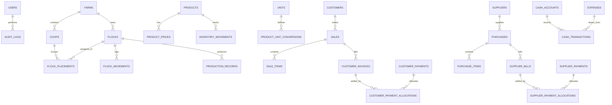

# Desain Basis Data (Database Design) - Sistem Manajemen Peternakan Puyuh

Dokumen ini mendefinisikan skema basis data PostgreSQL, relasi, tipe data, indeks, dan aturan integritas untuk Sistem Manajemen Peternakan Puyuh berdasarkan spesifikasi [`PROMPT.md`](file:///C:/Users/HYPE%20AMD/Videos/Manajamen_Kandang/PROMPT.md).

---

## 1. Konvensi & Aturan Teknis
1. **Format Identitas**: Seluruh tabel menggunakan primary key `UUID` (default `gen_random_uuid()`) atau `BIGSERIAL` terstandarisasi. Disarankan `UUID` untuk id publik dan keamanan.
2. **Penamaan**: Snake case (`table_name`, `column_name`).
3. **Mata Uang & Angka Desimal**: Menggunakan `NUMERIC(15, 2)` untuk nominal uang dan `NUMERIC(12, 3)` untuk kuantitas pakan/timbangan (kg/liter) guna menghindari kesalahan floating point.
4. **Audit Kolom Standar**: Setiap tabel utama memiliki:
   - `created_at TIMESTAMPTZ NOT NULL DEFAULT CURRENT_TIMESTAMP`
   - `updated_at TIMESTAMPTZ NOT NULL DEFAULT CURRENT_TIMESTAMP`
   - `created_by UUID REFERENCES users(id)` (opsional untuk transaksi)
5. **Soft Delete vs Immutability**:
   - Master data menggunakan `is_active BOOLEAN DEFAULT TRUE` atau soft delete.
   - Transaksi posted tidak dihapus; pembatalan/koreksi menggunakan dokumen koreksi (*Credit/Debit Note* / *Adjustment*).

---

## 2. Diagram Relasi Entitas (ERD Konseptual)



---

## 3. Kamus Data & Skema Tabel DDL

### 3.1 Master Data & Autentikasi

#### `users`
Menyimpan akun pengguna sistem peternakan.
```sql
CREATE TABLE users (
    id UUID PRIMARY KEY DEFAULT gen_random_uuid(),
    name VARCHAR(150) NOT NULL,
    email VARCHAR(150) UNIQUE NOT NULL,
    password_hash VARCHAR(255) NOT NULL,
    role VARCHAR(50) NOT NULL DEFAULT 'owner', -- 'owner', 'staff', 'admin'
    is_active BOOLEAN NOT NULL DEFAULT TRUE,
    created_at TIMESTAMPTZ NOT NULL DEFAULT CURRENT_TIMESTAMP,
    updated_at TIMESTAMPTZ NOT NULL DEFAULT CURRENT_TIMESTAMP
);
```

#### `farms`
Informasi profil peternakan.
```sql
CREATE TABLE farms (
    id UUID PRIMARY KEY DEFAULT gen_random_uuid(),
    code VARCHAR(50) UNIQUE NOT NULL,
    name VARCHAR(150) NOT NULL,
    address TEXT,
    phone VARCHAR(50),
    is_active BOOLEAN NOT NULL DEFAULT TRUE,
    created_at TIMESTAMPTZ NOT NULL DEFAULT CURRENT_TIMESTAMP,
    updated_at TIMESTAMPTZ NOT NULL DEFAULT CURRENT_TIMESTAMP
);
```

#### `coops` (Kandang)
Informasi kandang di dalam peternakan beserta kapasitasnya.
```sql
CREATE TABLE coops (
    id UUID PRIMARY KEY DEFAULT gen_random_uuid(),
    farm_id UUID NOT NULL REFERENCES farms(id) ON DELETE CASCADE,
    code VARCHAR(50) NOT NULL,
    name VARCHAR(150) NOT NULL,
    capacity INT NOT NULL DEFAULT 0,
    status VARCHAR(50) NOT NULL DEFAULT 'active', -- 'active', 'maintenance', 'inactive'
    notes TEXT,
    created_at TIMESTAMPTZ NOT NULL DEFAULT CURRENT_TIMESTAMP,
    updated_at TIMESTAMPTZ NOT NULL DEFAULT CURRENT_TIMESTAMP,
    CONSTRAINT uq_coop_farm_code UNIQUE (farm_id, code)
);
```

#### `units` (Satuan Barang)
Master satuan (butir, tray/rak, karung, kg, botol, liter).
```sql
CREATE TABLE units (
    id UUID PRIMARY KEY DEFAULT gen_random_uuid(),
    code VARCHAR(30) UNIQUE NOT NULL, -- e.g., 'BTR', 'RAK', 'KG', 'KRG'
    name VARCHAR(100) NOT NULL,
    is_base_unit BOOLEAN NOT NULL DEFAULT FALSE,
    created_at TIMESTAMPTZ NOT NULL DEFAULT CURRENT_TIMESTAMP
);
```

#### `products` (Master Produk & Barang Persediaan)
Mencakup puyuh, telur, pakan, obat, vaksin, dan perlengkapan.
```sql
CREATE TABLE products (
    id UUID PRIMARY KEY DEFAULT gen_random_uuid(),
    farm_id UUID NOT NULL REFERENCES farms(id) ON DELETE CASCADE,
    sku VARCHAR(60) NOT NULL,
    name VARCHAR(150) NOT NULL,
    category VARCHAR(50) NOT NULL, -- 'egg', 'feed', 'medicine', 'quail', 'equipment'
    default_unit_id UUID NOT NULL REFERENCES units(id),
    min_stock_alert NUMERIC(12, 3) NOT NULL DEFAULT 0,
    is_active BOOLEAN NOT NULL DEFAULT TRUE,
    description TEXT,
    created_at TIMESTAMPTZ NOT NULL DEFAULT CURRENT_TIMESTAMP,
    updated_at TIMESTAMPTZ NOT NULL DEFAULT CURRENT_TIMESTAMP,
    CONSTRAINT uq_product_farm_sku UNIQUE (farm_id, sku)
);
```

#### `product_unit_conversions` (Konversi Satuan)
Menjembatani konversi satuan (misal: 1 RAK telur = 30 BTR; 1 KRG pakan = 50 KG).
```sql
CREATE TABLE product_unit_conversions (
    id UUID PRIMARY KEY DEFAULT gen_random_uuid(),
    product_id UUID NOT NULL REFERENCES products(id) ON DELETE CASCADE,
    from_unit_id UUID NOT NULL REFERENCES units(id),
    to_unit_id UUID NOT NULL REFERENCES units(id),
    multiplier NUMERIC(12, 4) NOT NULL, -- e.g., from RAK to BTR: multiplier = 30
    created_at TIMESTAMPTZ NOT NULL DEFAULT CURRENT_TIMESTAMP,
    CONSTRAINT uq_prod_conversion UNIQUE (product_id, from_unit_id, to_unit_id)
);
```

#### `customers` & `suppliers`
Master data rekanan bisnis (pembeli telur dan pemasok pakan/bibit/obat).
```sql
CREATE TABLE customers (
    id UUID PRIMARY KEY DEFAULT gen_random_uuid(),
    farm_id UUID NOT NULL REFERENCES farms(id) ON DELETE CASCADE,
    code VARCHAR(50) NOT NULL,
    name VARCHAR(150) NOT NULL,
    phone VARCHAR(50),
    email VARCHAR(150),
    address TEXT,
    payment_terms_days INT NOT NULL DEFAULT 0, -- 0 = Cash on Delivery / Tunai
    is_active BOOLEAN NOT NULL DEFAULT TRUE,
    created_at TIMESTAMPTZ NOT NULL DEFAULT CURRENT_TIMESTAMP,
    updated_at TIMESTAMPTZ NOT NULL DEFAULT CURRENT_TIMESTAMP,
    CONSTRAINT uq_customer_farm_code UNIQUE (farm_id, code)
);

CREATE TABLE suppliers (
    id UUID PRIMARY KEY DEFAULT gen_random_uuid(),
    farm_id UUID NOT NULL REFERENCES farms(id) ON DELETE CASCADE,
    code VARCHAR(50) NOT NULL,
    name VARCHAR(150) NOT NULL,
    phone VARCHAR(50),
    email VARCHAR(150),
    address TEXT,
    payment_terms_days INT NOT NULL DEFAULT 0,
    is_active BOOLEAN NOT NULL DEFAULT TRUE,
    created_at TIMESTAMPTZ NOT NULL DEFAULT CURRENT_TIMESTAMP,
    updated_at TIMESTAMPTZ NOT NULL DEFAULT CURRENT_TIMESTAMP,
    CONSTRAINT uq_supplier_farm_code UNIQUE (farm_id, code)
);
```

---

### 3.2 Modul Populasi & Produksi

#### `flocks` (Kelompok / Batch Puyuh)
```sql
CREATE TABLE flocks (
    id UUID PRIMARY KEY DEFAULT gen_random_uuid(),
    farm_id UUID NOT NULL REFERENCES farms(id) ON DELETE CASCADE,
    code VARCHAR(50) NOT NULL,
    name VARCHAR(150) NOT NULL,
    entry_date DATE NOT NULL,
    initial_quantity INT NOT NULL,
    current_quantity INT NOT NULL,
    initial_age_days INT NOT NULL DEFAULT 1,
    status VARCHAR(50) NOT NULL DEFAULT 'active', -- 'brooding', 'growing', 'laying', 'culled', 'archived'
    notes TEXT,
    created_at TIMESTAMPTZ NOT NULL DEFAULT CURRENT_TIMESTAMP,
    updated_at TIMESTAMPTZ NOT NULL DEFAULT CURRENT_TIMESTAMP,
    CONSTRAINT uq_flock_farm_code UNIQUE (farm_id, code)
);
```

#### `flock_placements` (Alokasi Kandang per Batch)
Mencatat jumlah burung pada kandang tertentu.
```sql
CREATE TABLE flock_placements (
    id UUID PRIMARY KEY DEFAULT gen_random_uuid(),
    flock_id UUID NOT NULL REFERENCES flocks(id) ON DELETE CASCADE,
    coop_id UUID NOT NULL REFERENCES coops(id) ON DELETE RESTRICT,
    quantity INT NOT NULL DEFAULT 0,
    created_at TIMESTAMPTZ NOT NULL DEFAULT CURRENT_TIMESTAMP,
    updated_at TIMESTAMPTZ NOT NULL DEFAULT CURRENT_TIMESTAMP,
    CONSTRAINT uq_flock_coop UNIQUE (flock_id, coop_id)
);
```

#### `flock_movements` (Riwayat Pergerakan Populasi)
Setiap penambahan, kematian, afkir, atau perpindahan kandang dicatat di sini.
```sql
CREATE TABLE flock_movements (
    id UUID PRIMARY KEY DEFAULT gen_random_uuid(),
    flock_id UUID NOT NULL REFERENCES flocks(id) ON DELETE CASCADE,
    movement_date DATE NOT NULL,
    movement_type VARCHAR(50) NOT NULL, -- 'mortality', 'culling', 'transfer', 'addition'
    quantity INT NOT NULL, -- selalu positif
    from_coop_id UUID REFERENCES coops(id),
    to_coop_id UUID REFERENCES coops(id),
    reason TEXT,
    recorded_by UUID REFERENCES users(id),
    created_at TIMESTAMPTZ NOT NULL DEFAULT CURRENT_TIMESTAMP
);
```

#### `production_records` (Pencatatan Produksi Telur)
```sql
CREATE TABLE production_records (
    id UUID PRIMARY KEY DEFAULT gen_random_uuid(),
    farm_id UUID NOT NULL REFERENCES farms(id) ON DELETE CASCADE,
    flock_id UUID NOT NULL REFERENCES flocks(id) ON DELETE RESTRICT,
    coop_id UUID NOT NULL REFERENCES coops(id) ON DELETE RESTRICT,
    record_date DATE NOT NULL,
    total_eggs INT NOT NULL, -- total telur diambil
    damaged_eggs INT NOT NULL DEFAULT 0, -- telur pecah / abnormal
    saleable_eggs INT GENERATED ALWAYS AS (total_eggs - damaged_eggs) STORED, -- telur layak jual
    notes TEXT,
    recorded_by UUID REFERENCES users(id),
    created_at TIMESTAMPTZ NOT NULL DEFAULT CURRENT_TIMESTAMP,
    updated_at TIMESTAMPTZ NOT NULL DEFAULT CURRENT_TIMESTAMP,
    CONSTRAINT uq_prod_flock_coop_date UNIQUE (flock_id, coop_id, record_date)
);
```

---

### 3.3 Modul Persediaan (Inventory)

#### `inventory_movements` (Ledger Mutasi Stok Resmi)
Satu-satunya sumber kebenaran pergerakan stok barang fisik.
```sql
CREATE TABLE inventory_movements (
    id UUID PRIMARY KEY DEFAULT gen_random_uuid(),
    farm_id UUID NOT NULL REFERENCES farms(id) ON DELETE CASCADE,
    product_id UUID NOT NULL REFERENCES products(id) ON DELETE RESTRICT,
    unit_id UUID NOT NULL REFERENCES units(id),
    movement_date DATE NOT NULL,
    movement_type VARCHAR(50) NOT NULL, -- 'production_in', 'purchase_in', 'sales_out', 'usage_out', 'adjustment_in', 'adjustment_out', 'return_in'
    quantity NUMERIC(12, 3) NOT NULL, -- Positif untuk masuk, Negatif untuk keluar
    unit_cost NUMERIC(15, 2) NOT NULL DEFAULT 0,
    reference_type VARCHAR(50) NOT NULL, -- 'production_records', 'purchases', 'sales', 'stock_adjustments', 'feed_usage'
    reference_id UUID NOT NULL,
    notes TEXT,
    created_by UUID REFERENCES users(id),
    created_at TIMESTAMPTZ NOT NULL DEFAULT CURRENT_TIMESTAMP
);
CREATE INDEX idx_inv_movement_product ON inventory_movements(product_id, movement_date);
CREATE INDEX idx_inv_movement_ref ON inventory_movements(reference_type, reference_id);
```

#### `stock_adjustments` (Dokumen Penyesuaian / Stock Opname)
```sql
CREATE TABLE stock_adjustments (
    id UUID PRIMARY KEY DEFAULT gen_random_uuid(),
    farm_id UUID NOT NULL REFERENCES farms(id) ON DELETE CASCADE,
    adjustment_number VARCHAR(60) NOT NULL,
    adjustment_date DATE NOT NULL,
    status VARCHAR(30) NOT NULL DEFAULT 'posted', -- 'draft', 'posted', 'cancelled'
    reason TEXT NOT NULL,
    created_by UUID REFERENCES users(id),
    created_at TIMESTAMPTZ NOT NULL DEFAULT CURRENT_TIMESTAMP,
    CONSTRAINT uq_stock_adj_number UNIQUE (farm_id, adjustment_number)
);

CREATE TABLE stock_adjustment_items (
    id UUID PRIMARY KEY DEFAULT gen_random_uuid(),
    adjustment_id UUID NOT NULL REFERENCES stock_adjustments(id) ON DELETE CASCADE,
    product_id UUID NOT NULL REFERENCES products(id) ON DELETE RESTRICT,
    unit_id UUID NOT NULL REFERENCES units(id),
    system_qty NUMERIC(12, 3) NOT NULL,
    actual_qty NUMERIC(12, 3) NOT NULL,
    difference_qty NUMERIC(12, 3) GENERATED ALWAYS AS (actual_qty - system_qty) STORED,
    notes TEXT
);
```

#### `feed_usages` (Pencatatan Pemakaian Pakan & Obat Harian)
```sql
CREATE TABLE feed_usages (
    id UUID PRIMARY KEY DEFAULT gen_random_uuid(),
    farm_id UUID NOT NULL REFERENCES farms(id) ON DELETE CASCADE,
    flock_id UUID NOT NULL REFERENCES flocks(id) ON DELETE RESTRICT,
    coop_id UUID NOT NULL REFERENCES coops(id) ON DELETE RESTRICT,
    product_id UUID NOT NULL REFERENCES products(id) ON DELETE RESTRICT,
    unit_id UUID NOT NULL REFERENCES units(id),
    usage_date DATE NOT NULL,
    quantity NUMERIC(12, 3) NOT NULL,
    notes TEXT,
    recorded_by UUID REFERENCES users(id),
    created_at TIMESTAMPTZ NOT NULL DEFAULT CURRENT_TIMESTAMP
);
```

---

### 3.4 Modul Harga, Pembelian & Penjualan

#### `product_prices` (Riwayat Harga Master)
```sql
CREATE TABLE product_prices (
    id UUID PRIMARY KEY DEFAULT gen_random_uuid(),
    product_id UUID NOT NULL REFERENCES products(id) ON DELETE CASCADE,
    unit_id UUID NOT NULL REFERENCES units(id),
    price_type VARCHAR(30) NOT NULL, -- 'sell', 'buy'
    price NUMERIC(15, 2) NOT NULL,
    valid_from DATE NOT NULL,
    valid_to DATE, -- NULL = masih aktif
    notes TEXT,
    created_by UUID REFERENCES users(id),
    created_at TIMESTAMPTZ NOT NULL DEFAULT CURRENT_TIMESTAMP
);
CREATE INDEX idx_product_prices_lookup ON product_prices(product_id, price_type, valid_from);
```

#### `sales` & `sale_items` (Penjualan Telur/Produk)
```sql
CREATE TABLE sales (
    id UUID PRIMARY KEY DEFAULT gen_random_uuid(),
    farm_id UUID NOT NULL REFERENCES farms(id) ON DELETE CASCADE,
    customer_id UUID NOT NULL REFERENCES customers(id) ON DELETE RESTRICT,
    sale_number VARCHAR(60) NOT NULL,
    sale_date DATE NOT NULL,
    status VARCHAR(30) NOT NULL DEFAULT 'draft', -- 'draft', 'posted', 'cancelled'
    subtotal NUMERIC(15, 2) NOT NULL DEFAULT 0,
    discount_amount NUMERIC(15, 2) NOT NULL DEFAULT 0,
    shipping_fee NUMERIC(15, 2) NOT NULL DEFAULT 0,
    other_fees NUMERIC(15, 2) NOT NULL DEFAULT 0,
    grand_total NUMERIC(15, 2) NOT NULL DEFAULT 0,
    notes TEXT,
    created_by UUID REFERENCES users(id),
    created_at TIMESTAMPTZ NOT NULL DEFAULT CURRENT_TIMESTAMP,
    updated_at TIMESTAMPTZ NOT NULL DEFAULT CURRENT_TIMESTAMP,
    CONSTRAINT uq_sale_number UNIQUE (farm_id, sale_number)
);

CREATE TABLE sale_items (
    id UUID PRIMARY KEY DEFAULT gen_random_uuid(),
    sale_id UUID NOT NULL REFERENCES sales(id) ON DELETE CASCADE,
    product_id UUID NOT NULL REFERENCES products(id) ON DELETE RESTRICT,
    unit_id UUID NOT NULL REFERENCES units(id),
    quantity NUMERIC(12, 3) NOT NULL,
    unit_price NUMERIC(15, 2) NOT NULL, -- SNAPSHOT harga saat posting
    discount_amount NUMERIC(15, 2) NOT NULL DEFAULT 0,
    subtotal NUMERIC(15, 2) NOT NULL,
    notes TEXT
);
```

#### `purchases` & `purchase_items` (Pembelian Pakan/Kebutuhan)
```sql
CREATE TABLE purchases (
    id UUID PRIMARY KEY DEFAULT gen_random_uuid(),
    farm_id UUID NOT NULL REFERENCES farms(id) ON DELETE CASCADE,
    supplier_id UUID NOT NULL REFERENCES suppliers(id) ON DELETE RESTRICT,
    purchase_number VARCHAR(60) NOT NULL,
    purchase_date DATE NOT NULL,
    status VARCHAR(30) NOT NULL DEFAULT 'draft', -- 'draft', 'posted', 'cancelled'
    subtotal NUMERIC(15, 2) NOT NULL DEFAULT 0,
    discount_amount NUMERIC(15, 2) NOT NULL DEFAULT 0,
    shipping_fee NUMERIC(15, 2) NOT NULL DEFAULT 0,
    other_fees NUMERIC(15, 2) NOT NULL DEFAULT 0,
    grand_total NUMERIC(15, 2) NOT NULL DEFAULT 0,
    notes TEXT,
    created_by UUID REFERENCES users(id),
    created_at TIMESTAMPTZ NOT NULL DEFAULT CURRENT_TIMESTAMP,
    updated_at TIMESTAMPTZ NOT NULL DEFAULT CURRENT_TIMESTAMP,
    CONSTRAINT uq_purchase_number UNIQUE (farm_id, purchase_number)
);

CREATE TABLE purchase_items (
    id UUID PRIMARY KEY DEFAULT gen_random_uuid(),
    purchase_id UUID NOT NULL REFERENCES purchases(id) ON DELETE CASCADE,
    product_id UUID NOT NULL REFERENCES products(id) ON DELETE RESTRICT,
    unit_id UUID NOT NULL REFERENCES units(id),
    quantity NUMERIC(12, 3) NOT NULL,
    unit_price NUMERIC(15, 2) NOT NULL, -- SNAPSHOT harga beli saat posting
    discount_amount NUMERIC(15, 2) NOT NULL DEFAULT 0,
    subtotal NUMERIC(15, 2) NOT NULL,
    notes TEXT
);
```

#### `credit_debit_notes` (Koreksi Transaksi & Retur)
```sql
CREATE TABLE credit_debit_notes (
    id UUID PRIMARY KEY DEFAULT gen_random_uuid(),
    farm_id UUID NOT NULL REFERENCES farms(id) ON DELETE CASCADE,
    note_number VARCHAR(60) NOT NULL,
    note_type VARCHAR(20) NOT NULL, -- 'credit_note' (mengurangi tagihan), 'debit_note' (menambah tagihan)
    reference_type VARCHAR(30) NOT NULL, -- 'sale', 'purchase'
    reference_id UUID NOT NULL, -- id dari sales atau purchases
    note_date DATE NOT NULL,
    amount NUMERIC(15, 2) NOT NULL,
    reason TEXT NOT NULL,
    created_by UUID REFERENCES users(id),
    created_at TIMESTAMPTZ NOT NULL DEFAULT CURRENT_TIMESTAMP,
    CONSTRAINT uq_note_number UNIQUE (farm_id, note_number)
);
```

---

### 3.5 Modul Tagihan, Pembayaran & Kas

#### `customer_invoices` & `customer_payments`
```sql
CREATE TABLE customer_invoices (
    id UUID PRIMARY KEY DEFAULT gen_random_uuid(),
    farm_id UUID NOT NULL REFERENCES farms(id) ON DELETE CASCADE,
    sale_id UUID NOT NULL REFERENCES sales(id) ON DELETE RESTRICT,
    customer_id UUID NOT NULL REFERENCES customers(id) ON DELETE RESTRICT,
    invoice_number VARCHAR(60) NOT NULL,
    invoice_date DATE NOT NULL,
    due_date DATE NOT NULL,
    total_amount NUMERIC(15, 2) NOT NULL,
    paid_amount NUMERIC(15, 2) NOT NULL DEFAULT 0,
    status VARCHAR(30) NOT NULL DEFAULT 'unpaid', -- 'unpaid', 'partially_paid', 'paid', 'cancelled'
    created_at TIMESTAMPTZ NOT NULL DEFAULT CURRENT_TIMESTAMP,
    updated_at TIMESTAMPTZ NOT NULL DEFAULT CURRENT_TIMESTAMP,
    CONSTRAINT uq_invoice_number UNIQUE (farm_id, invoice_number)
);

CREATE TABLE customer_payments (
    id UUID PRIMARY KEY DEFAULT gen_random_uuid(),
    farm_id UUID NOT NULL REFERENCES farms(id) ON DELETE CASCADE,
    customer_id UUID NOT NULL REFERENCES customers(id) ON DELETE RESTRICT,
    payment_number VARCHAR(60) NOT NULL,
    payment_date DATE NOT NULL,
    amount NUMERIC(15, 2) NOT NULL,
    payment_method VARCHAR(50) NOT NULL, -- 'cash', 'bank_transfer'
    cash_account_id UUID REFERENCES cash_accounts(id),
    reference_notes TEXT,
    created_by UUID REFERENCES users(id),
    created_at TIMESTAMPTZ NOT NULL DEFAULT CURRENT_TIMESTAMP,
    CONSTRAINT uq_customer_payment_number UNIQUE (farm_id, payment_number)
);

CREATE TABLE customer_payment_allocations (
    id UUID PRIMARY KEY DEFAULT gen_random_uuid(),
    payment_id UUID NOT NULL REFERENCES customer_payments(id) ON DELETE CASCADE,
    invoice_id UUID NOT NULL REFERENCES customer_invoices(id) ON DELETE RESTRICT,
    allocated_amount NUMERIC(15, 2) NOT NULL,
    created_at TIMESTAMPTZ NOT NULL DEFAULT CURRENT_TIMESTAMP
);
```

#### `supplier_bills` & `supplier_payments`
```sql
CREATE TABLE supplier_bills (
    id UUID PRIMARY KEY DEFAULT gen_random_uuid(),
    farm_id UUID NOT NULL REFERENCES farms(id) ON DELETE CASCADE,
    purchase_id UUID NOT NULL REFERENCES purchases(id) ON DELETE RESTRICT,
    supplier_id UUID NOT NULL REFERENCES suppliers(id) ON DELETE RESTRICT,
    bill_number VARCHAR(60) NOT NULL,
    bill_date DATE NOT NULL,
    due_date DATE NOT NULL,
    total_amount NUMERIC(15, 2) NOT NULL,
    paid_amount NUMERIC(15, 2) NOT NULL DEFAULT 0,
    status VARCHAR(30) NOT NULL DEFAULT 'unpaid', -- 'unpaid', 'partially_paid', 'paid', 'cancelled'
    created_at TIMESTAMPTZ NOT NULL DEFAULT CURRENT_TIMESTAMP,
    updated_at TIMESTAMPTZ NOT NULL DEFAULT CURRENT_TIMESTAMP,
    CONSTRAINT uq_bill_number UNIQUE (farm_id, bill_number)
);

CREATE TABLE supplier_payments (
    id UUID PRIMARY KEY DEFAULT gen_random_uuid(),
    farm_id UUID NOT NULL REFERENCES farms(id) ON DELETE CASCADE,
    supplier_id UUID NOT NULL REFERENCES suppliers(id) ON DELETE RESTRICT,
    payment_number VARCHAR(60) NOT NULL,
    payment_date DATE NOT NULL,
    amount NUMERIC(15, 2) NOT NULL,
    payment_method VARCHAR(50) NOT NULL,
    cash_account_id UUID REFERENCES cash_accounts(id),
    reference_notes TEXT,
    created_by UUID REFERENCES users(id),
    created_at TIMESTAMPTZ NOT NULL DEFAULT CURRENT_TIMESTAMP,
    CONSTRAINT uq_supplier_payment_number UNIQUE (farm_id, payment_number)
);

CREATE TABLE supplier_payment_allocations (
    id UUID PRIMARY KEY DEFAULT gen_random_uuid(),
    payment_id UUID NOT NULL REFERENCES supplier_payments(id) ON DELETE CASCADE,
    bill_id UUID NOT NULL REFERENCES supplier_bills(id) ON DELETE RESTRICT,
    allocated_amount NUMERIC(15, 2) NOT NULL,
    created_at TIMESTAMPTZ NOT NULL DEFAULT CURRENT_TIMESTAMP
);
```

#### `cash_accounts`, `cash_transactions` & `expenses`
```sql
CREATE TABLE cash_accounts (
    id UUID PRIMARY KEY DEFAULT gen_random_uuid(),
    farm_id UUID NOT NULL REFERENCES farms(id) ON DELETE CASCADE,
    name VARCHAR(100) NOT NULL, -- e.g., 'Kas Utama Kandang', 'BCA Peternakan'
    account_type VARCHAR(50) NOT NULL DEFAULT 'cash', -- 'cash', 'bank'
    account_number VARCHAR(100),
    initial_balance NUMERIC(15, 2) NOT NULL DEFAULT 0,
    current_balance NUMERIC(15, 2) NOT NULL DEFAULT 0,
    is_active BOOLEAN NOT NULL DEFAULT TRUE,
    created_at TIMESTAMPTZ NOT NULL DEFAULT CURRENT_TIMESTAMP,
    updated_at TIMESTAMPTZ NOT NULL DEFAULT CURRENT_TIMESTAMP
);

CREATE TABLE expenses (
    id UUID PRIMARY KEY DEFAULT gen_random_uuid(),
    farm_id UUID NOT NULL REFERENCES farms(id) ON DELETE CASCADE,
    expense_number VARCHAR(60) NOT NULL,
    expense_date DATE NOT NULL,
    category VARCHAR(80) NOT NULL, -- 'electricity', 'labor', 'maintenance', 'bedding', 'other'
    amount NUMERIC(15, 2) NOT NULL,
    cash_account_id UUID NOT NULL REFERENCES cash_accounts(id),
    recipient VARCHAR(150),
    notes TEXT,
    created_by UUID REFERENCES users(id),
    created_at TIMESTAMPTZ NOT NULL DEFAULT CURRENT_TIMESTAMP,
    CONSTRAINT uq_expense_number UNIQUE (farm_id, expense_number)
);

CREATE TABLE cash_transactions (
    id UUID PRIMARY KEY DEFAULT gen_random_uuid(),
    cash_account_id UUID NOT NULL REFERENCES cash_accounts(id) ON DELETE RESTRICT,
    transaction_date DATE NOT NULL,
    transaction_type VARCHAR(20) NOT NULL, -- 'in', 'out'
    amount NUMERIC(15, 2) NOT NULL,
    balance_after NUMERIC(15, 2) NOT NULL,
    source_type VARCHAR(50) NOT NULL, -- 'customer_payment', 'supplier_payment', 'expense', 'transfer'
    source_id UUID NOT NULL,
    description TEXT,
    created_at TIMESTAMPTZ NOT NULL DEFAULT CURRENT_TIMESTAMP
);
```

#### `audit_logs` (Jejak Rekam Sistem)
```sql
CREATE TABLE audit_logs (
    id UUID PRIMARY KEY DEFAULT gen_random_uuid(),
    user_id UUID REFERENCES users(id),
    action VARCHAR(50) NOT NULL, -- 'CREATE', 'UPDATE', 'POST', 'CANCEL', 'DELETE'
    entity_name VARCHAR(60) NOT NULL, -- 'sales', 'production', 'inventory'
    entity_id UUID NOT NULL,
    changes JSONB,
    ip_address VARCHAR(50),
    created_at TIMESTAMPTZ NOT NULL DEFAULT CURRENT_TIMESTAMP
);
CREATE INDEX idx_audit_logs_entity ON audit_logs(entity_name, entity_id);
```
